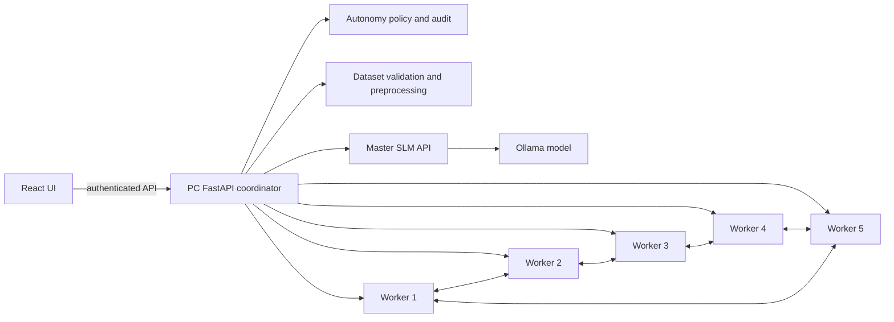

# DFL-SLM Digital Twin Network Project

This repository implements an agentic decentralized federated-learning system with a small-language-model coordinator and a digital-twin inventory for five Jetson workers. The Windows PC hosts the FastAPI coordinator and React UI; the master Jetson hosts the SLM; workers train and exchange model weights peer-to-peer. The Datasets module supports the official MNIST and CIFAR-10 datasets, with preprocessing, worker-shard shipping, bounded NAS, autonomy controls, audit history, and PC-only final evaluations. Arbitrary dataset upload remains disabled.

The Model Studio lets the user choose a bounded MNIST CNN, verifies and installs its initial weights on all configured workers, and starts distributed training from an explicit button. The experiment viewer is read-only; new training runs must follow the model-design flow.

Experiment groups and per-round worker metrics are stored in the master-side SQLite database configured by `DFL_TRAINING_RESULTS_PATH` (default `experiments.sqlite3`). Existing `experiments.json` results are imported on first startup and left in place. The MNIST viewer reports worker-local validation accuracy, precision, recall, F1, confusion matrices, resource use, peer transfer, and waiting time; its accuracy chart downloads as SVG. Chat responses to results requests include a natural-language summary read from those persisted experiment records.

The master uses `DFL_TRAINING_PEER_TIMEOUT_SECONDS` for an individual worker API request (default 60 seconds) and `DFL_TRAINING_ROUND_TIMEOUT_SECONDS` for the overall wait for each federated round (default 7,200 seconds). Workers use `DFL_PEER_TIMEOUT_SECONDS` (default 600 seconds) for peer weight transfers and waiting for neighboring workers to finish local epochs; this longer budget avoids failing faster workers while a Jetson is still training. If a worker fails, the master cancels the remaining workers before attempting to clean their run memory. While a round is running, workers report the current local epoch and whether they are training or exchanging peer weights.

The worker-training deployment prepares five-way disjoint CIFAR-10 shards in a temporary directory from the indexed source shards; it does not overwrite the existing three-worker shard files. This is for the legacy CIFAR worker-training service bootstrap and is separate from the Model Studio training flow. Legacy CIFAR training uses `DFL_DATASET_BATCH_SIZE` for local updates (default 32) to bound worker memory.

The Worker Operations page reports the top 30 worker processes by resident memory and refreshes every five seconds. It can request cancellation of DFL training or NAS, reboot an idle worker, and clear retained in-memory training state plus Linux filesystem caches. It does not kill arbitrary PIDs or delete datasets, installed models, experiment history, or logs. Restart the PC coordinator to load the new API routes, then update the worker training service and authenticated memory-cleanup helper with `.\deploy\deploy_worker_training.ps1` and `.\deploy\deploy_worker_memory_cleanup.ps1`.

The **Agent Supervisor** page runs agentic mode. Give it a dataset and a target mean worker validation accuracy (plus experiment and time budgets); a server-side supervisor then preprocesses and ships the data, distributes one initial model, runs a baseline DFL experiment, and lets the on-device SLM choose each improvement step (architecture search, topology optimization, retraining with the best configuration) from a compact, state-filtered tool set. It checks worker readiness and free memory before every step, cleans worker memory and retries a transient failure once, falls back to a deterministic policy when the SLM answers badly, records every decision with its source, keeps running when the page is closed, and resumes after a coordinator restart. You can ask the agent about the run at any time. See [docs/agentic-slm-architecture.md](docs/agentic-slm-architecture.md). The SLM Assistant page is human mode: the SLM advises and never executes. The floating Cluster status bot answers worker, supervisor-run, and action-history questions from coordinator database records without calling a language model. After pulling, install the backend with `python -m pip install -e .\dtn\backend` in the coordinator's Python environment and restart the coordinator to apply the database migration.

## Official datasets

Prepare both official datasets once from the repository root:

```powershell
.\.venv\Scripts\python.exe scripts\prepare_mnist_dataset.py
.\.venv\Scripts\python.exe scripts\prepare_cifar10_dataset.py
```

The CIFAR-10 helper downloads the official archive only when it is not cached, verifies its checksum, and registers the official 50,000-image training and 10,000-image test splits under `data/datasets/cifar10`. In the Datasets module, preview examples, select MNIST or CIFAR-10, and choose stratified or Dirichlet shard splits (α=0.1, 0.3, 0.5, or 0.7) before dispatching preprocessing from the PC backend. The official training split is divided into train/validation data and worker shards; the held-out official test split remains untouched.

Datasets-page preprocessing requests use `replace_existing: true` and the authenticated worker `PUT` endpoint to replace only each worker's training shard and metadata while preserving its initial model; replacement is rejected while training or NAS is active.

The current milestone record is M1-M9. M7 remains partial; see [docs/results-report.md](docs/results-report.md) for measured results, current limitations, and the M1-M9 status table.

## Architecture



The browser talks only to the PC coordinator. The coordinator authenticates and validates actions before automatic dispatch. For DFL, workers train local models and exchange weights directly; held-out evaluation is performed separately. CIFAR-10 and MNIST results are reported separately.

Dashboard-added workers use the next sequential worker ID and require both a status API port and a training API port. The device API token authenticates both services. Registration synchronizes the master worker inventory and every worker's peer list; the dashboard reports training readiness separately from status reachability. A node is not included in training until its training API is installed and reachable.

## Phase 0 status

- PC: Windows 10 Pro, Python 3.10.11, 31.7 GiB RAM, about 215.9 GiB free on D:
- Master: `192.168.11.15`
- Previously provisioned workers: `192.168.11.123`, `192.168.11.14`, `192.168.11.13`
- The new worker4 is configured at `192.168.11.75` for SSH user `jetson5`; its authenticated status service is active, but its training service must be installed before it can join DFL runs.
- Worker5 (`dfl-worker5`, `192.168.11.76`, SSH user `hammad`) is in the cluster inventory with status and training services installed. Worker4 (`.75`) is now named `dfl-worker4`. All Jetsons run headless (`multi-user.target`) since 2026-11-17, which freed about 1.7-2.1 GB of RAM per device.
- SSH key-based batch access and the listed software/hardware checks apply to the four previously provisioned Jetsons.
- The master currently has Ollama 0.34.0 and `llama3.2:1b` installed. The coordinator is configured for `qwen3.5:4b`; run `.\deploy\deploy_master_slm.ps1` after active training finishes to pull the model and deploy the updated service.
- The four previously provisioned Jetsons use the distinct hostnames `dfl-master`, `dfl-worker1`, `dfl-worker2`, and `dfl-worker3`; each has a unique `/etc/machine-id`.
- Python 3.10 is retained on the PC and Jetsons as requested.
- The originally requested indoor CO2 CSV path was not supplied. Phase 4 uses the official CIFAR-10 dataset with disjoint stratified worker shards; no CO2 experiment results are claimed.

See [docs/hardware-discovery.md](./docs/hardware-discovery.md) for the hardware findings and recommendations, and [docs/hardware-probe-results/](./docs/hardware-probe-results/) for the raw output from each Jetson.

Phase 1 deployment, API details, live readings, authentication checks, and TCP connectivity results are recorded in [docs/phase1-network-device.md](./docs/phase1-network-device.md).

## Phase 2 status

- FastAPI coordinator on the PC at `0.0.0.0:8000`, using bearer-token authentication, SQLite/Alembic, authenticated device/history endpoints, and a WebSocket event stream.
- Background polling records live authenticated status from all five workers and the master; timeouts mark nodes offline.
- React/TypeScript/Vite dashboard on port `5173` shows the real device metrics and master/worker topology. Dashboard workflows use the PC backend; SLM chat connects directly to the master.
- Backend pytest, frontend Vitest, production build, live PC/device/peer TCP connectivity, and worker offline/restore checks passed.

See [docs/phase2-coordinator.md](./docs/phase2-coordinator.md) for setup, API usage, verification output, network results, and the security limitation that this phase uses trusted-LAN HTTP without TLS.

## Phase 3 status

- SLM master service on `dfl-master:5003`; the existing authenticated device-status agent remains on `dfl-master:5002`.
- The Assistant sends the original user question directly to the master RAG API; the coordinator does not intent-match, execute, or rewrite chat requests. Dashboard and worker workflows remain on the coordinator.
- Master SQLite stores chat history and successful action results. The master retrieves relevant action records and prior turns for a bounded natural-language SLM prompt; chat recommends evidence-based next steps but does not execute actions or return action JSON.
- Browser chat uses the existing coordinator login token, scoped on the master to read-only RAG endpoints. The privileged `MASTER_SLM_API_TOKEN` remains server-side, with CORS restricted to configured UI origins.

See [docs/phase3-slm-master.md](./docs/phase3-slm-master.md) for deployment, endpoints, action validation, real prompt results, tests, and memory/latency measurements.

## Phase 4 status

- Worker training APIs are installed on `dfl-worker1..3:5004`; the existing status services remain on port `5001`. The master coordinates on `dfl-master:5003`, leaving its status service on `5002`.
- Each Jetson received only its own stratified CIFAR-10 training shard. The held-out test split and full training set are on the master evaluator only.
- Real 10-round, 5-local-epoch, three-seed Ring and Mesh experiments completed with peer-to-peer weight exchange and held-out accuracy, loss, macro-F1, runtime, RAM, and communication metrics recorded per round.
- A matching centralized baseline completed on the master: mean held-out accuracy 57.06% across the three seeds, with peak process RSS of 3,445.7 MB.
- A worker-stop failure injection was detected by the coordinator, and the stopped service was restored successfully.

See [docs/phase4-worker-training.md](./docs/phase4-worker-training.md) for dataset inspection, measured smoke/full experiment results, direct peer-log evidence, deployment details, and tests.

## Phase 5 status

- The master and workers support directed Ring, bidirectional Ring, Mesh, chain, and star graphs. Ring remains available as an alias for directed Ring.
- Deterministic Dirichlet CIFAR-10 shards (α=0.3 and 0.5, seed 2026) are stored separately per worker; only each worker's own shard is deployed.
- The authenticated SLM `optimize_topology` action runs measured candidate sweeps. A configurable reward-based selector is compared with seeded-random and best-observed-accuracy baselines; no GNN or APG is claimed.
- The Topology page shows the peer graph, active topology, candidate reward breakdown, and selector/baseline comparison. Direct worker-to-worker exchanges were verified in packet captures.
- The full 30-run matrix (five topologies × two Dirichlet splits × three seeds; 10 rounds × 5 epochs) completed in about 58.6 minutes. The reward selector chose bidirectional Ring at α=0.5; the best mean held-out accuracy was 47.283%.

See [docs/phase5-topology-optimization.md](./docs/phase5-topology-optimization.md) for packet counts, reward configuration, pilot timing, full-matrix metrics, and baseline comparison.

## Phase 6 status

- The worker-local CIFAR-10 CNN search tests eight bounded architectures (maximum 11,466 parameters, below a 12,000 cap) on GPU using each worker's own stratified training shard and validation split. Search has a 300-second and 2,048 MiB RSS cap; the held-out test set is only used after architecture selection.
- The master selects one common architecture by mean worker validation accuracy, then runs identical-architecture DFL with Phase 5's bidirectional Ring, alongside the fixed model and a centralized fixed-model reference.
- A real eight-candidate GPU search and one-round pilot completed; `b1_c16_k5` was selected (11,466 parameters). The full 10-round, 5-epoch, three-seed comparison completed on all three Jetsons: NAS DFL reached 61.63% mean held-out accuracy and 0.6136 macro-F1, versus 55.07% and 0.5459 for fixed DFL. The centralized fixed reference reached 56.93% accuracy.
- The complete nine-run comparison took 20 minutes 2 seconds. NAS runtime including amortized search averaged 97.91 seconds per run, peak process RSS was 2,508.9 MiB, and peer communication averaged 2,609,813 bytes per run (about 2.09× fixed DFL).

See [docs/phase6-neural-architecture-search.md](./docs/phase6-neural-architecture-search.md) for the design, all full-search candidate measurements, per-seed results, and runtime/memory/communication comparisons.

## M7-M9 status

- **M7 partial:** worker-crash and backend-restart tests passed. The post-worker-reboot training acceptance timed out; master reboot and security re-check remain pending.
- **M8 pass:** centralized `b1_c16_k5` CIFAR-10 baseline completed on the PC with three seeds and Phase 6 training settings.
- **M9 pass:** this README, [docs/results-report.md](docs/results-report.md), and a GET-only local demo are available. M9 changes do not access the cluster.

See [docs/results-report.md](docs/results-report.md) for the summarized saved results and caveats.

## PC setup and commands

Use the tested Windows PC environment: Python 3.10.11, TensorFlow 2.15.1 CPU, and Node.js/npm. Create a virtual environment and install the project components:

```powershell
py -3.10 -m venv .venv-tf
& .\.venv-tf\Scripts\python.exe -m pip install --upgrade pip
& .\.venv-tf\Scripts\python.exe -m pip install tensorflow==2.15.1
Push-Location .\dtn\backend
& ..\..\.venv-tf\Scripts\python.exe -m pip install -e ".[test]"
Pop-Location
& .\.venv-tf\Scripts\python.exe -m pip install -r .\master\requirements.txt
```

The backend reads its local configuration when it starts. Configure `.env` locally from `.env.example` if needed; never print or commit secret values. Start the PC backend in one PowerShell window and the UI in another:

```powershell
$env:PYTHONPATH = 'dtn\backend'
& .\.venv-tf\Scripts\python.exe -m app.main
```

```powershell
Push-Location .\dtn\frontend
npm ci
npm run dev
```

PC-only evaluation scripts:

```powershell
& .\.venv-tf\Scripts\python.exe .\scripts\mnist_final_test_eval.py
& .\.venv-tf\Scripts\python.exe .\scripts\m8_centralized_nas_baseline.py
```

Test suites:

```powershell
& .\.venv-tf\Scripts\python.exe -m pytest --import-mode=importlib -q tests master\tests
Push-Location .\dtn\backend
& ..\..\.venv-tf\Scripts\python.exe -m pytest -q
Pop-Location
Push-Location .\dtn\frontend
npm run lint
npm test
npm run build
Pop-Location
```

## Safety rules

- State-changing actions execute automatically after schema validation. The mode switch and approval queue are removed; global STOP remains available and blocks state changes.
- Before any hardware operation, confirm no training or NAS is active on the Worker Operations page. Before backend restart, back up the SQLite database with `scripts/backup_backend_database.py`. Deploy one worker at a time with the approved deployment script, verified backup, hash check, and rollback path. Never edit Jetson files directly.
- Keep global STOP inactive only for authorized work. Check listener PID/start time/parent chain, health, routes, migration revision, and autonomy state after backend changes.
- Never print tokens or `.env` contents. Do not commit `.env`, keys, generated data, or unverified metrics.
- Keep test data out of training and tuning. Label validation and test metrics explicitly; report only measured results.
- No commit is created automatically. Review `git status --short` before and after a task.

## Project layout

```text
dfl-slm-dtn/
├── README.md
├── .env.example
├── .gitattributes
├── .gitignore
├── docs/
│   └── hardware-probe-results/
├── config/
├── common/
├── dtn/
├── master/
├── worker/
├── topology_opt/
├── slm_finetune/
├── deploy/
├── scripts/
└── tests/
```

## Running the read-only Jetson probe

From Windows PowerShell, use `cmd.exe` redirection so the LF-formatted script is sent as file bytes instead of being converted to Windows line endings:

```powershell
$script = (Resolve-Path -LiteralPath '.\scripts\probe_device.sh').Path
$command = 'ssh -o BatchMode=yes hammad@192.168.11.15 "bash -s" < "' + $script + '"'
& $env:ComSpec /d /c $command
if ($LASTEXITCODE -ne 0) { throw "Probe failed with exit code $LASTEXITCODE" }
```

Repeat with each worker IP to collect another hardware report.

## Phase 1 operations

The Phase 1 all-node deployment command is historical. Current hardware changes require explicit authorization, a passing preflight, one node per deployment, a verified backup, and the documented rollback procedure. Do not use a bulk deployment command for M5/M7 work.

The current test commands are listed under [PC setup and commands](#pc-setup-and-commands). Phase-specific verification output remains in the linked reports.

```powershell
python -m unittest discover -v
python -m scripts.check_phase1
```

Hardware and runtime version decisions are recorded in [docs/setup-notes.md](./docs/setup-notes.md). Model fine-tuning has not been tested; see the memory limitations in the hardware discovery report.
